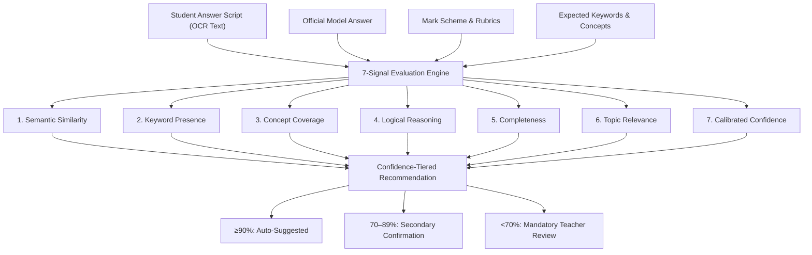

# IntelliGrade — AI Answer Script Evaluation & Document Intelligence Platform

> Production-grade, full-stack AI examination answer script evaluation platform & multi-engine OCR document intelligence system built with FastAPI, React 19, and Celery.

[](https://github.com/rkcodes-ai/IntelliGrade/actions/workflows/test.yml)
[](https://github.com/rkcodes-ai/IntelliGrade/actions/workflows/lint.yml)
[](https://github.com/rkcodes-ai/IntelliGrade/actions/workflows/security.yml)
[](https://github.com/rkcodes-ai/IntelliGrade/actions/workflows/docker.yml)

---

## Overview

**IntelliGrade** is an enterprise-grade academic platform designed to automate the digitization, layout analysis, transcription, and multi-signal evaluation of handwritten student examination answer scripts.

The platform bridges physical handwritten student scripts with official institutional examination materials (question papers, model answer keys, and mark schemes) through a modular, multi-engine OCR architecture, advanced document intelligence extensions, and a 7-signal explainable AI evaluation engine with a strict human-in-the-loop teacher review workflow.

---

## Key Capabilities

- **Multi-Tenant Academic Hierarchy:** Strict tenant isolation with `Institution` as the root entity, supporting Campuses, Departments, Programs, Courses, Academic Years, Semesters, Sections, Subjects, Allocations, and Student Enrollments.
- **Enterprise Security & IAM:** RBAC with 4 canonical roles (Super Admin, Institution Admin, Teacher, Student), 150+ granular permission codes, JWT access tokens with rotating httpOnly refresh cookies, account lockout policies, rate limiting, and immutable audit logging.
- **Academic Assessment Engine:** Complete lifecycle management for Assessments, Exams, Exam Schedules, Question Banks, Question Papers, Blueprints, Rubrics, and Answer Keys with versioning and draft-to-approval workflows.
- **Multi-Engine OCR Platform:** High-precision transcription leveraging Tesseract, EasyOCR, and isolated subprocess bridges for PaddleOCR, Surya, docTR, TrOCR, and Google Cloud Vision, unified via character/word-level OCR Fusion and Ensemble consensus.
- **Document Intelligence Extensions:**
  - **Mathematical Formula Recognition:** LaTeX formula extraction via `pix2tex` (LaTeX-OCR).
  - **Language Quality Analysis:** Grammar, spelling, and sentence-structure checking via local `LanguageTool` Java integration.
  - **Indian Multilingual Support:** Language and script identification using `fastText lid.176` and dedicated Indian-language Tesseract models.
  - **AI Reference Answer Builder:** Automated reference answer generation using offline local LLMs (`Qwen2.5-1.5B-Instruct` GGUF via `llama-cpp-python`) and cloud LLMs (OpenAI, Anthropic).
- **7-Signal Explainable AI Evaluation:** Answer scoring across semantic similarity, keyword matching, concept coverage, reasoning, completeness, relevance, and calibrated confidence.
- **Teacher Review & Result Finalization:** Confidence-tiered teacher review ($\ge 90\%$ auto-suggested, $70\% - 89\%$ secondary review, $< 70\%$ mandatory human evaluation) with an immutable result state machine (`draft` $\rightarrow$ `under_review` $\rightarrow$ `approved` $\rightarrow$ `locked` $\rightarrow$ `published`).
- **Institutional Analytics & Background Reporting:** Real-time mark distributions, question-difficulty metrics, and asynchronous PDF/Excel/CSV report generation via Celery.
- **Production Hardening:** Non-root multi-stage Docker containers, TLS-terminating Nginx reverse proxy, Prometheus `/metrics` exporter, and Grafana monitoring dashboards.

---

## Verified Technology Stack

| Layer | Technologies |
|---|---|
| **Frontend** | React 19, TypeScript, Vite, Tailwind CSS, Redux Toolkit, React Router, TanStack Query, React Hook Form, Zod, Axios, Lucide Icons, Radix UI primitives |
| **Backend** | Python (3.13 / 3.14), FastAPI (async ASGI), SQLAlchemy 2.x (async ORM), Pydantic v2, Alembic (21 revisions), PostgreSQL (`asyncpg`), Redis, Celery |
| **Storage** | MinIO / S3-compatible object storage with SHA-256 deduplication and presigned URLs |
| **Infrastructure** | Docker, Docker Compose, Nginx, Prometheus, Grafana, GitHub Actions |
| **Testing** | Pytest (1520+ tests), pytest-asyncio, Vitest (575 tests), Playwright E2E, Locust load testing, Black, Ruff, isort, ESLint, Prettier |

---

## Subsystem Architecture & Provider Matrix

To maintain production integrity and avoid exaggeration, IntelliGrade clearly categorizes provider implementations:

| Subsystem | Engine / Provider | Classification | Status & Requirements |
|---|---|---|---|
| **OCR Engines** | **Tesseract OCR** | Local / Offline | **Fully functional.** Real binary execution with custom PSM/OEM profiles. |
| | **EasyOCR** | Local / Offline | **Fully functional.** PyTorch-based inference with GPU toggle. |
| | **PaddleOCR** | Local Isolated Bridge | **Fully functional.** Subprocess-isolated in `.venv-paddleocr` to prevent dependency conflicts. |
| | **Surya OCR** | Local Isolated Bridge | **Fully functional.** Subprocess-isolated in `.venv-surya` for layout-aware text detection. |
| | **docTR OCR** | Local Isolated Bridge | **Fully functional.** Subprocess-isolated in `.venv-doctr` for end-to-end line transcription. |
| | **TrOCR** | Local Isolated Bridge | **Fully functional.** Subprocess-isolated in `.venv-trocr` for handwritten transformer recognition. |
| | **Google Cloud Vision** | Cloud Provider | **Fully implemented.** Requires user-supplied service account credentials JSON. |
| | **Azure AI Doc Intel** | Cloud Stub | **Interface-conformant integration point.** Configurable via endpoint and API key. |
| | **AWS Textract** | Cloud Stub | **Interface-conformant integration point.** Configurable via AWS credential chain. |
| **Document Intelligence** | **pix2tex (LaTeX-OCR)** | Local Isolated Bridge | **Fully functional.** Mathematical equation extraction in `.venv-math`. |
| | **LanguageTool** | Local Java Runtime | **Fully functional.** Standalone Java JAR distribution for grammar/style checking. |
| | **fastText Language ID** | Local Isolated Bridge | **Fully functional.** `lid.176` language classifier in `.venv-langid`. |
| **AI Evaluation** | **LexicalHeuristic** | Built-in Local Heuristic | **Fully functional.** Deterministic 7-signal scoring with zero external API dependencies. |
| | **Qwen2.5-1.5B (GGUF)** | Local Offline LLM | **Fully functional.** Runs locally via `llama-cpp-python` in `.venv-reference-ai`. |
| | **OpenAI (`gpt-4o-mini`)** | Cloud Provider | **Integration point.** Fully wired in service layer; requires `OPENAI_API_KEY`. |
| | **Anthropic (`claude-3-5`)** | Cloud Provider | **Integration point.** Fully wired in service layer; requires `ANTHROPIC_API_KEY`. |

---

## 7-Signal AI Evaluation Methodology

The answer script evaluation pipeline (`AnswerEvaluationService`) scores responses across 7 distinct dimensions:



1. **Semantic Similarity:** Computes vector embedding and lexical alignment against the official model answer.
2. **Keyword Presence:** Evaluates exact and lemmatized occurrences of mandatory and optional expected keywords.
3. **Concept Coverage:** Validates presence of core thematic concepts aligned with Bloom's taxonomy.
4. **Logical Reasoning:** Measures transitional phrasing and step-by-step explanatory deduction.
5. **Completeness:** Assesses depth and breadth against allocated mark scheme ranges.
6. **Topic Relevance:** Detects off-topic digressions and irrelevant filler content.
7. **Calibrated Confidence:** Generates an overall reliability metric guiding teacher review thresholds.

---

## Interactive Benchmark Demo & Demo Data

The frontend includes an interactive evaluation benchmark at `/dataset-demo` demonstrating:
- Ground truth answer key alignment for 35 questions (20 MCQs and 15 Short Answer questions).
- Real-time scoring calculations, itemized mark tables, and automated model statistics (Pearson correlation $r = 0.8848$).
- Student score distributions and teacher verification workflows.

> [!NOTE]
> **Data Privacy Notice:** The demonstration operates entirely against the bundled synthetic fixture:  
> [`frontend/src/data/dataset_demo_data.json`](frontend/src/data/dataset_demo_data.json)  
> All student identifiers (`Student_1`, `Student_2`, ...) and scores in this fixture are anonymized. Raw scanned student PDFs and private institutional datasets are strictly excluded from version control to adhere to student privacy regulations (FERPA/GDPR).

---

## Quick Start

### 1. Prerequisites
- Docker & Docker Compose (v2)
- (Or for local development: Python 3.13+, Node.js 20+, PostgreSQL 16+, Redis 7+, Tesseract OCR 5+)

### 2. Launch with Docker Compose

```bash
# Clone the repository
git clone https://github.com/rkcodes-ai/IntelliGrade.git
cd IntelliGrade

# Copy root environment template
cp .env.example .env

# Start all services (Postgres, Redis, MinIO, Backend, Frontend)
docker compose up -d
```

- **Frontend UI:** [http://localhost:5173](http://localhost:5173)
- **FastAPI OpenAPI Docs:** [http://localhost:8000/docs](http://localhost:8000/docs)
- **MinIO Console:** [http://localhost:9001](http://localhost:9001) (User: `intelligrade`, Password: `change_me_dev_only`)

---

## Local Development (Without Docker)

### Backend Setup

```bash
cd backend
python -m venv .venv
source .venv/bin/activate  # On Windows: .venv\Scripts\activate

pip install --upgrade pip
pip install -e ".[dev]"

# Copy backend environment template
cp .env.example .env

# Run database migrations
alembic upgrade head

# Start FastAPI development server
uvicorn app.main:app --reload --port 8000
```

### Frontend Setup

```bash
cd frontend
npm install

# Copy frontend environment template
cp .env.example .env.local

# Start Vite development server
npm run dev
```

### Background Worker Setup

```bash
cd backend
celery -A app.tasks.celery_app worker --loglevel=info
```

---

## Production Deployment & Monitoring

Production deployment utilizes `docker-compose.prod.yml` and `docker-compose.monitoring.yml` behind an `nginx` TLS-terminating reverse proxy:

- **Security Hardened:** Multi-stage non-root container user (`intelligrade:intelligrade`), read-only root filesystems where appropriate, and isolated internal Docker bridge networks.
- **Monitoring:** Real-time metrics scraped by Prometheus from `/metrics` and visualized via custom Grafana dashboards (`monitoring/grafana/dashboards/intelligrade-overview.json`).
- **Operational Documentation:**
  - [Production Checklist](docs/production-checklist.md)
  - [Operations Runbook](docs/runbook.md)
  - [Monitoring Guide](docs/monitoring-guide.md)
  - [Incident Response Guide](docs/incident-response-guide.md)
  - [Disaster Recovery & Backup Guide](docs/backup-guide.md)

---

## Testing & Quality Gate

```bash
# Backend test suite (1520+ unit and integration tests)
pytest backend/tests

# Backend code formatting and linting
ruff check backend/app
black --check backend/app
isort --check-only backend/app

# Frontend unit and integration tests (575 tests)
npm test --prefix frontend

# Frontend typecheck & production build
npm run typecheck --prefix frontend
npm run build --prefix frontend
```

---

## Repository Structure

```
IntelliGrade/
├── .github/workflows/         # CI/CD: build, test, lint, security, docker, deploy
├── backend/                   # FastAPI backend application root
│   ├── alembic/               # 21 database migration revisions
│   ├── app/                   # Source: api, core, db, middleware, models, repositories, schemas, services, tasks
│   ├── loadtests/             # Locust load testing suite
│   ├── tests/                 # Pytest test suite (100+ files, 1520+ tests)
│   ├── Dockerfile             # Multi-stage container build
│   └── pyproject.toml         # Backend dependencies and tool configurations
├── frontend/                  # React 19 + TypeScript frontend application root
│   ├── src/                   # Source: api, components, context, data, hooks, layouts, pages, routes, store
│   ├── tests/                 # Vitest test suite (80 suites, 575 tests)
│   ├── Dockerfile             # Multi-stage production container build
│   └── package.json           # Frontend dependencies and scripts
├── docs/                      # 28 architectural and operational documentation guides
├── docker-compose.yml         # Development multi-container stack
├── docker-compose.prod.yml    # Production container stack
├── docker-compose.monitoring.yml # Prometheus + Grafana stack
├── monitoring/                # Prometheus configuration & Grafana dashboards
├── nginx/                     # Reverse proxy configuration
└── shared/                    # Shared TypeScript constants (permissions, roles)
```

---

## License

Proprietary — All rights reserved. See [LICENSE](LICENSE). No reuse, distribution, or modification is permitted without prior written authorization.
